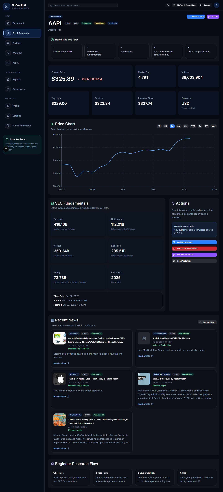
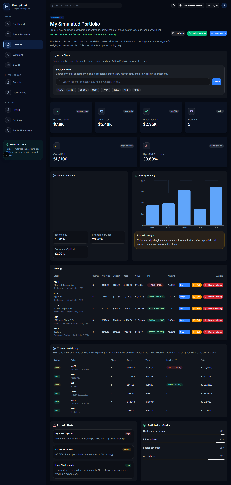
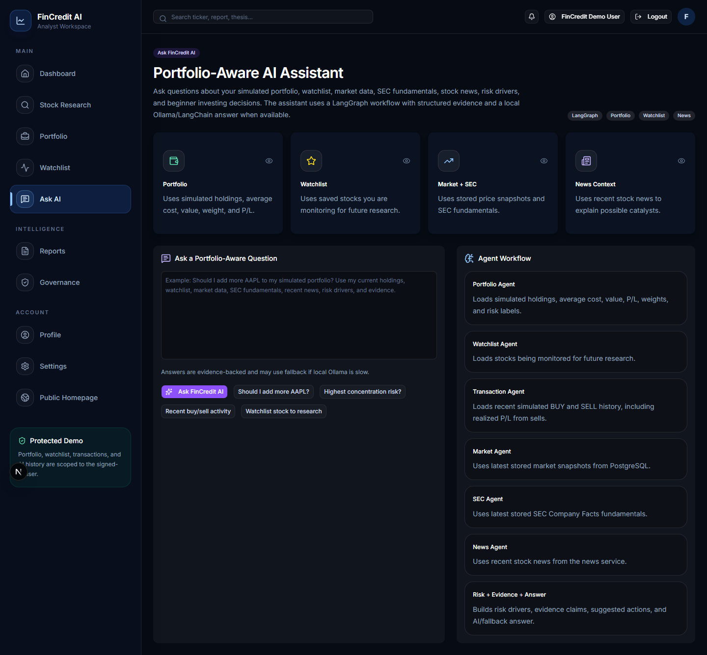
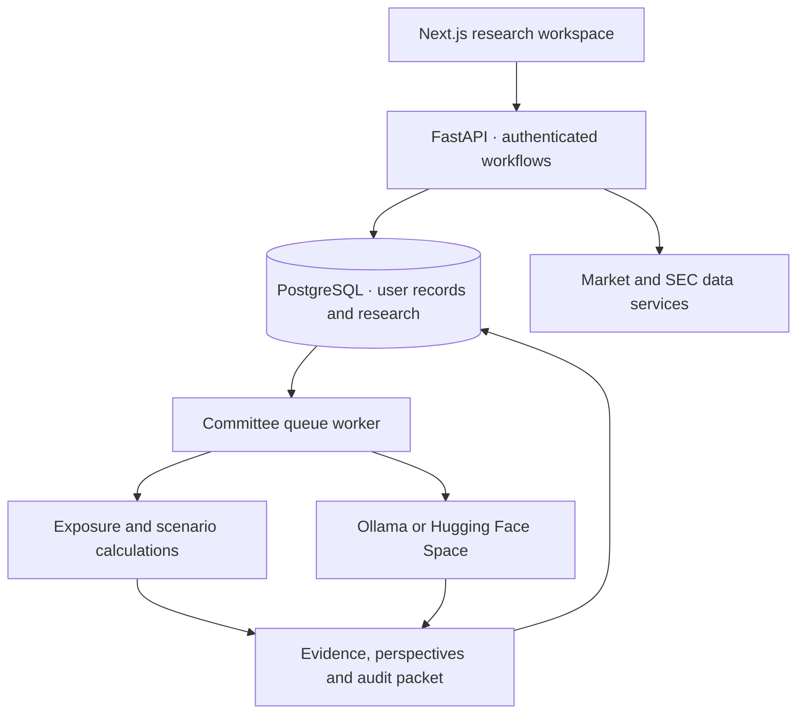

# FinCredit AI

**A financial research workspace that connects stock analysis, a simulated portfolio, and an evidence-based AI review.**

FinCredit AI helps a user research a company, understand how it fits their holdings, and challenge an investment thesis before making a simulated trade. It combines a Next.js interface, FastAPI services, PostgreSQL records, deterministic portfolio calculations, and Ollama or Hugging Face model interpretations.

**You can explore the project on GitHub without installing or deploying anything.** Start with the walkthrough below, then follow the architecture and source links. Local setup is optional.

> Release status: the latest Investment Committee implementation is on [`feat/committee-release`](https://github.com/sreemaanshivkirth05/fincredit-ai/tree/feat/committee-release), proposed in [PR #5](https://github.com/sreemaanshivkirth05/fincredit-ai/pull/5). Build checks passed; full acceptance testing for this release is pending. This project is for research and paper trading, not real order execution.

## New visual direction

The complete light editorial redesign is on [`feat/editorial-ui-redesign`](https://github.com/sreemaanshivkirth05/fincredit-ai/tree/feat/editorial-ui-redesign). It builds on the committee release with a new home page, research overview, navigation and shared visual system across the application. See [design notes](DESIGN.md). Existing screenshots below predate this redesign; updated browser captures are pending.

## Explore the product

| Start here | What you will learn |
| --- | --- |
| [Complete product tour](docs/PROJECT_TOUR.md) | What each screen does and how the workflows connect |
| [Architecture and source map](#how-it-works) | Where the UI, API, calculations, agents and persistence live |
| [Investment Committee](#investment-committee) | How opposing perspectives use the same saved evidence |
| [Release scope and limitations](docs/RELEASE-0.2.md) | What is implemented, what remains unverified, and what is future work |
| [Optional local setup](docs/DEPLOYMENT.md#local-docker-windows--docker-desktop) | How to run the project yourself |
| [GitHub Codespaces](docs/CODESPACES.md) | Private ports, manual Compose startup, and optional local Ollama inference |
| [Simulation Lab Phase 2](docs/SIMULATION_PHASE2.md) | Bounded agent execution, audit trail, cancellation, and Codespaces API test |
| [Professional agent system](docs/SIMULATION_AGENT_SYSTEM.md) | Role mandates, desk workflow, decision quality, and committee synthesis |

## The problem

Stock research often separates company information from the investor's actual portfolio. A company thesis can sound persuasive while ignoring concentration, stale source data, missing fundamentals or the effect of a market decline.

FinCredit brings those records into one workflow. Calculations provide exposure and scenario results; model interpretations help articulate a thesis and its counterargument. The user can inspect the supporting evidence and retains control of all simulated portfolio changes.

## A walkthrough in five steps

### 1. Research a company

Search a ticker to inspect its market snapshot, historical chart, SEC fundamentals and available news. Source availability depends on upstream data services.

### 2. Build a simulated portfolio

Record paper positions and buy/sell transactions. Review cost basis, unrealized and realized P/L, allocation and concentration. The scenario tools keep currencies separate rather than adding unlike amounts together.

### 3. Ask a question using your own context

The Ask workflow combines the signed-in user's holdings, recent transactions and watchlist with available company records. Answers include evidence, risk drivers and research diagnostics. When a model is unavailable, the existing workflow can provide explicitly labelled deterministic output.

### 4. Challenge the thesis with the committee

The new committee saves an evidence snapshot, calculates hypothetical shocks, requests a bull perspective and then a bear response, and performs limited mechanical citation/percentage checks. Review the resulting brief, debate, evidence, scenarios and execution timeline.

The committee UI is implemented in this release branch. Its updated screenshots and full browser acceptance results are not yet included; the images above document the earlier application and do not represent the new design.

### 5. Return to the evidence

Saved committee packets retain the original evidence, model provenance and workflow version. Users can reopen or export a review and compare its assumptions with later research. The committee cannot execute trades.

## Investment Committee

Eight responsibilities make the workflow explicit. They do **not** represent eight independent language models.

| Responsibility | Implementation |
| --- | --- |
| Supervisor | Starts a bounded job and records execution events |
| Fundamental analyst | Collects stored market and SEC context; does not reconcile fact periods |
| Quant analyst | Calculates three deterministic price-shock scenarios by currency |
| Portfolio risk officer | Records concentration concerns and missing source checks |
| Bull analyst | Requests a supportable upside interpretation from the configured model |
| Bear analyst | Challenges the bull perspective using the same supplied evidence |
| Evidence auditor | Checks evidence-ID existence and explicit percentage literals |
| Synthesizer | Assembles the research packet for human review |

The queue is persisted in PostgreSQL and processed by a separate worker. One active review per user, bounded model calls, cancellation and explicit partial results keep execution visible. Evidence audit results do not establish semantic correctness or investment accuracy.

## How it works

Ask AI uses the existing LangGraph workflow. The new committee uses a separate bounded orchestration service and durable worker, reusing the existing context collectors and analytics.

| Code area | What to inspect |
| --- | --- |
| [Frontend routes](frontend/app) | Dashboard, stock research, portfolio, watchlist, Ask, committee, reports and settings |
| [Committee workspace](frontend/app/committee/page.tsx) | Saved research, brief/debate/evidence/scenario/timeline views |
| [API routes](backend/app/api) | Authentication, financial records and research endpoints |
| [Committee service](backend/app/services/committee_service.py) | Bounded review, source snapshots and limited audit |
| [Queue worker](backend/app/committee_worker.py) | Job claims, cancellation handling and interrupted-run recovery |
| [LangGraph research](backend/app/agents/fincredit_graph.py) | Existing portfolio-aware Ask workflow |
| [Portfolio analytics](backend/app/services/portfolio_analytics.py) | Deterministic concentration and currency-separated scenarios |
| [Model provider](backend/app/services/model_provider.py) | Ollama/Hugging Face routing and failure handling |
| [Database models](backend/app/models) | Holdings, transactions, source records and research persistence |
| [Hugging Face Space](deployment/huggingface-space) | Cloud model application and configuration instructions |

## Technology

Next.js 16, React, TypeScript and Tailwind provide the interface. FastAPI, SQLAlchemy and PostgreSQL provide the API and persistence. LangGraph coordinates the existing Ask workflow. Ollama and Hugging Face provide model inference; Docker Compose packages the services. Playwright covers existing browser workflows.

No paid inference provider is required. The free cloud configuration uses Qwen3-8B on Hugging Face ZeroGPU for agent reasoning and a compact financial DistilRoBERTa classifier on the Space CPU. Local inference consumes the user's hardware resources; free Hugging Face availability depends on account access and quota.

## Current scope

Implemented: company research, paper portfolios and transaction history, watchlists, portfolio-aware Ask AI, scenario calculations, the committee workflow, saved research, configuration display and existing report/governance/admin screens.

Important boundaries:

- Committee research uses stored records; snapshot capture time is not source freshness.
- Two model viewpoints may share errors. Mechanical evidence checks are not fact verification.
- Personal portfolios, transactions, watchlists and committee history are user-scoped. Legacy report/governance records form a shared workspace library.
- The wider roadmap—including Monte Carlo, the portfolio digital twin, scheduling and knowledge graphs—is future work, not a claim about this release.
- The latest frontend build, backend imports and schema compilation passed. Full updated browser, database, Docker and live-model checks remain pending. See the [release checklist](docs/RELEASE-0.2.md).

## Run it locally, if you want to

Use the [step-by-step local setup](docs/DEPLOYMENT.md#local-docker-windows--docker-desktop). Docker starts the frontend, API, PostgreSQL and committee worker. Configure Ollama or your own Hugging Face Space credentials server-side. Do not commit tokens.

For a quick code review, no setup is necessary: follow the source map above or read the [complete product tour](docs/PROJECT_TOUR.md).
