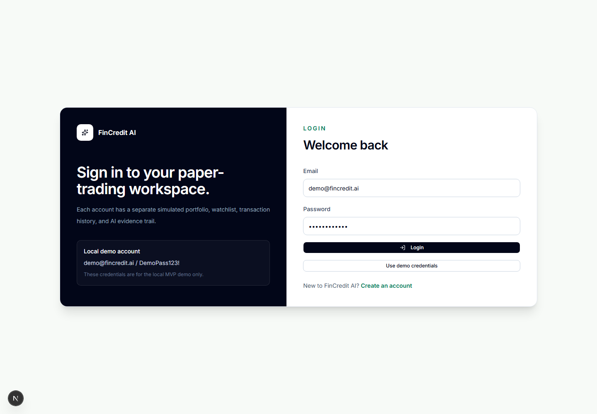
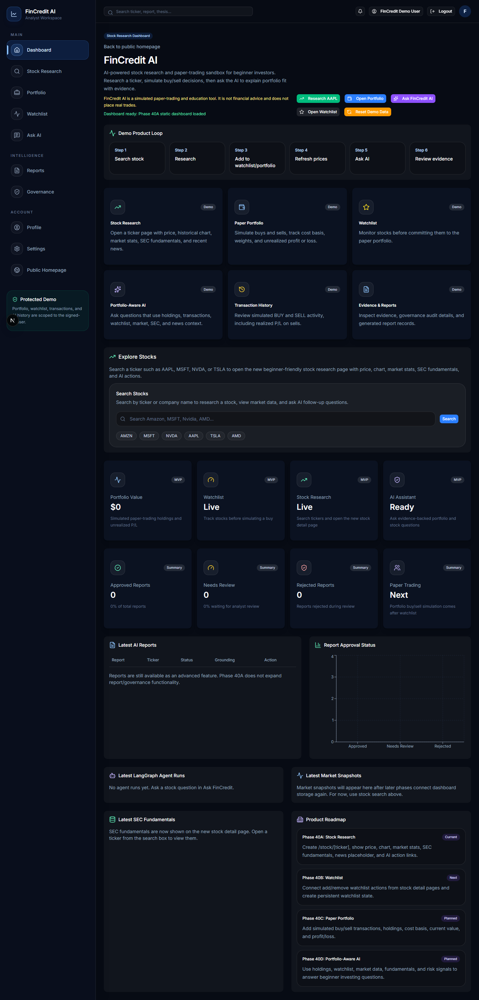
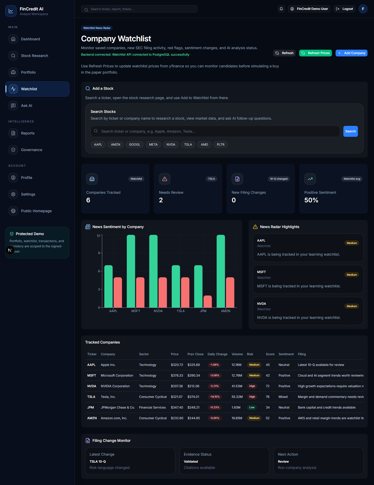
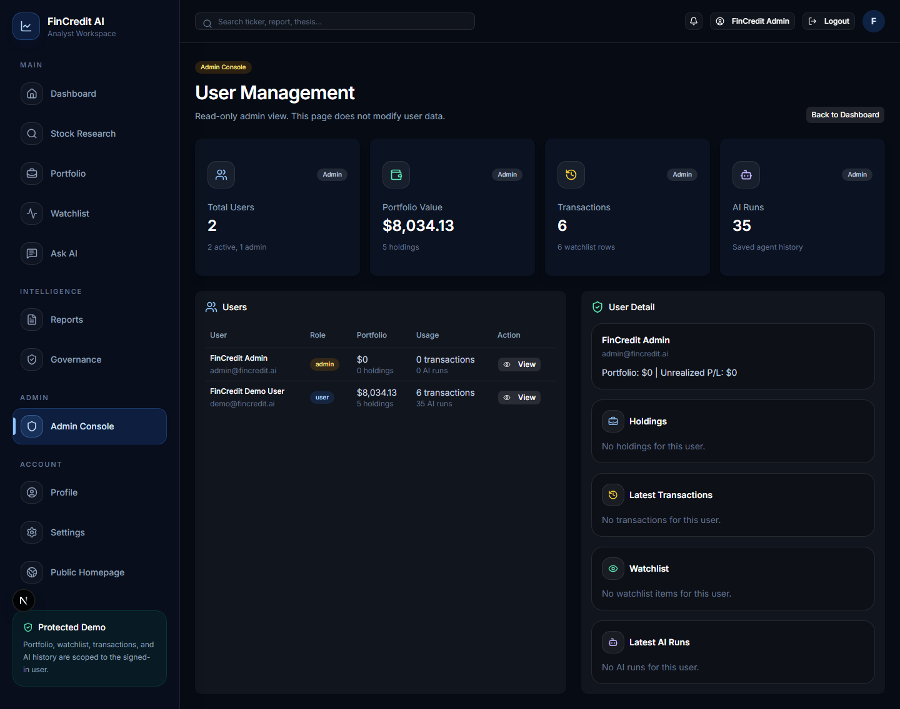

# FinCredit AI: complete product tour

This guide is for someone viewing the repository without running the application. Screenshots in the repository show the earlier application; the new committee and shared navigation are implemented in the release branch and await updated screenshots.

## Example research journey

A user holds several technology stocks and asks: “Where is my portfolio concentrated, and what could undermine my investment thesis?”

1. **Stock research** supplies company records: price snapshots, historical charts, available SEC facts and news.
2. **Portfolio** supplies the user's simulated positions and transaction history.
3. **Scenario tools** calculate hypothetical price shocks, keeping each currency separate. These are arithmetic assumptions rather than predictions.
4. **Ask FinCredit** answers a focused question using the available user and company context.
5. **Investment Committee** captures a versioned snapshot, calculates exposure/scenarios, collects opposing model interpretations and records audit limitations.
6. The user inspects the **Evidence** and **Timeline** views, exports the packet if useful, and decides whether any simulated portfolio change is justified.

No simulated or real trade is created by the committee.

## Screen-by-screen map

| Screen | User task | Source |
| --- | --- | --- |
| Home | Understand the application and enter the workspace | [Home](../frontend/app/page.tsx) |
| Login / Register | Create or access an account | [Authentication screens](../frontend/app/login/page.tsx) |
| Overview | Review saved workspace data and enter a research workflow | [Dashboard](../frontend/app/dashboard/page.tsx) |
| Stock research | Inspect a ticker's market information, fundamentals and news | [Stock page](../frontend/app/stock/[ticker]/page.tsx) |
| Company | Read the existing company-oriented view | [Company page](../frontend/app/company/[ticker]/page.tsx) |
| Portfolio | Review holdings, paper trades and portfolio scenarios | [Portfolio](../frontend/app/portfolio/page.tsx) |
| Watchlist | Save companies to investigate | [Watchlist](../frontend/app/watchlist/page.tsx) |
| Ask FinCredit | Ask a portfolio-aware question and inspect diagnostics | [Ask](../frontend/app/ask/page.tsx) |
| Committee | Challenge a thesis and retain the evidence packet | [Committee](../frontend/app/committee/page.tsx) |
| Reports | Browse the existing shared report library | [Reports](../frontend/app/reports/page.tsx) |
| Governance | Inspect existing report review information | [Governance](../frontend/app/governance/page.tsx) |
| Admin | Inspect administrative activity | [Admin](../frontend/app/admin/page.tsx) |
| Profile | View account information | [Profile](../frontend/app/profile/page.tsx) |
| Settings | Inspect actual model routing configuration | [Settings](../frontend/app/settings/page.tsx) |

## What the committee views mean

**Saved research** lists the user's recent reviews, including queued, running, completed, partial, cancelled and failed jobs. Reopening a completed review displays its stored packet rather than generating a new answer.

**Brief** summarizes the purpose of the packet and highlights missing sources and questions requiring human attention. It does not issue a buy/sell instruction.

**Debate** places the bull and bear interpretations beside their source references and audit findings. The bear receives the bull's perspective in one bounded round. Both use the same configured model.

**Evidence** separates source claims from model interpretation. Identifiers such as E1 refer to saved records. Advanced view exposes the original snapshot for technical inspection.

**Scenarios** presents calculated remaining value and change for broad decline, severe decline and dominant-sector decline assumptions, separately for each currency.

**Timeline** records which responsibilities ran and when. These are operational event summaries, not a transcript of private model reasoning.

**Export** downloads the packet as JSON, including the question, version, timestamps, evidence and results. Guided/advanced mode changes presentation, not the calculations.

## Existing screen gallery

These are earlier application captures, not screenshots of the new committee release.

### Entry and overview

### Research and portfolio

### AI and administration

## Suggested code-reading order

Start with the [committee screen](../frontend/app/committee/page.tsx), then the [committee API](../backend/app/api/committee.py), [worker](../backend/app/committee_worker.py) and [service](../backend/app/services/committee_service.py). Follow the calls into [portfolio analytics](../backend/app/services/portfolio_analytics.py) and [model routing](../backend/app/services/model_provider.py). Finally inspect the [run model](../backend/app/models/committee_run.py) to see what is retained.

For the existing conversational flow, read [Ask service](../backend/app/services/ask_service.py) and [LangGraph workflow](../backend/app/agents/fincredit_graph.py).

See [release scope](RELEASE-0.2.md) for known limitations and pending validation. Local execution instructions are optional; a hosted service is not needed to understand or review this repository.
